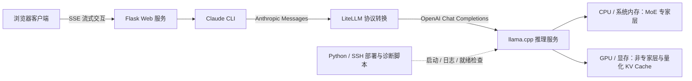

# AI 基础设施实践：大模型推理服务部署与优化

**AI Infra · LLM Inference · Model Serving · GPU 显存优化 · 部署自动化**

在 **6GB 显存、32GB 内存的消费级硬件**上，完成 35B MoE 量化模型的本地部署、CPU/GPU 资源配置、推理性能调优和 API 服务化，并打通 Web 客户端调用链路。

本项目展示 AI Infrastructure（AI 基础设施）方向的工程实践：**让模型在有限资源下运行，将其封装成应用能够调用的服务，并用实验和日志定位性能与兼容性问题。** 主要覆盖单机推理部署与服务接入。

## 项目成果

| 交付内容 | 实现结果 |
| --- | --- |
| 大模型本地部署 | 在 GTX 1060 Max-Q 6GB + 32GB 系统内存环境运行 Ornith-1.0-35B Q4_K_M；模型权重由系统内存与显存共同承载 |
| 推理性能优化 | 历史实验中，纯 CPU 配置约 10.3 token/s，切换到兼容运行时并启用 GPU 卸载后约 17.8 token/s；后续配置约 18 token/s |
| 显存与上下文配置 | 使用 GPU KV Cache 量化，配置 192K 上下文容量；历史记录中显存占用约 4.5–4.9GB |
| 模型服务化 | 提供 OpenAI 兼容推理 API，通过 LiteLLM 协议转换接入 Claude CLI 与 Web 客户端 |
| 部署自动化 | 编写 Python 远程启动、日志检查、服务就绪检查和资源诊断脚本 |

> **实验口径：** 上述数据来自历史部署与调试记录。约 18 token/s 为当时短提示请求的生成阶段速度；192K 为配置的上下文容量，二者不代表满 192K 输入下的吞吐结果。CPU 与 GPU 数据涉及运行时版本变化，用于展示部署配置对比；未开展统一条件下的并发压测或 SLA 验证。

## 核心能力与实现

### 1. 模型部署与运行时兼容性排查

围绕模型格式、推理引擎、CUDA 运行库和 GPU 架构完成环境适配。针对服务可以启动、但模型计算仍落在 CPU 的问题，通过设备识别与层分配日志确认 GPU 实际使用情况，并在历史实验中选择可正常卸载该模型的 llama.cpp b8600 配置。

**体现能力：** 模型部署、依赖与版本管理、运行日志分析、软硬件兼容性排查。

### 2. CPU/GPU 混合推理与显存预算

面对模型权重大于显存的限制，将 MoE 专家层保留在 CPU，将可卸载的非专家层放到 GPU；结合模型预载、GPU KV Cache 量化与 Flash Attention，平衡系统内存、显存和推理速度。

这里的 CPU/GPU 混合执行由 llama.cpp 提供，项目工作集中在部署策略选择、参数配置与实验验证。

**体现能力：** 资源受限条件下的推理配置、模型与 KV Cache 内存开销分析、性能与容量权衡。

### 3. 推理性能分析与配置对照实验

区分提示处理（prefill）与逐 token 生成（decode）阶段，读取运行时 timing、GPU 显存与系统内存信息，对比 CPU/GPU 执行、KV Cache 放置、线程数、电源计划和进程优先级等因素。

保留无明显收益及不兼容方案的结果，避免把所有参数变化都视作有效优化。例如，历史实验中的线程数调整和内存锁定没有带来稳定的生成速度提升；所测版本与模型组合下，投机解码未取得收益。

**体现能力：** 性能测量、瓶颈定位、对照实验与结果解释。

### 4. 模型服务化与应用接入

将本地推理节点以 OpenAI 兼容 API 对外提供服务，通过 LiteLLM 转换 OpenAI 与 Anthropic 请求协议，连接 Claude CLI 和 Flask Web 客户端。客户端支持 SSE 流式输出、后端配置切换、会话管理和停止生成。

**体现能力：** Model Serving、API 集成、协议适配、流式响应与跨主机服务接入。

### 5. 部署自动化与基础运行维护

使用 Python 和 SSH 完成远程启动流程，包含旧进程处理、启动配置写入、进程优先级设置、加载日志轮询和 `/health` 就绪检查；配套脚本检查 CUDA 设备、显存、系统内存与服务 timing。协议转换服务提供 systemd 配置示例。

**体现能力：** 运维脚本开发、启动流程自动化、服务就绪判断与故障诊断。

## 服务架构

推理节点与 Web 接入节点可以分别部署。Web 层的多后端能力通过配置选择实现；本项目展示的是单机推理与跨主机接入实践。

## 技术栈

| 方向 | 使用的技术 |
| --- | --- |
| 模型推理 | llama.cpp、GGUF、MoE、Q4_K_M 权重量化 |
| 资源优化 | CPU/GPU 卸载配置、KV Cache q8_0 量化、Flash Attention |
| 服务接入 | OpenAI 兼容 API、LiteLLM、Anthropic Messages、Claude CLI |
| 应用与流式通信 | Python、Flask、SSE、HTML / CSS / JavaScript |
| 部署与诊断 | SSH / Paramiko、PowerShell、systemd 配置示例、nvidia-smi、运行时日志 |

## 代码与技术材料

| 入口 | 内容 |
| --- | --- |
| [部署与性能实验说明](docs/deployment.md) | 硬件环境、已验证配置、实验结果与适用边界 |
| [远程启动脚本](scripts/start_ornith.py) | 启动推理进程、检查加载日志与服务就绪状态 |
| [推理测速与资源采样](scripts/quick_speed.py) | 发送样例请求，读取生成 timing、显存和内存信息 |
| [环境与性能诊断](scripts/diag_perf.py) | 电源计划、内存频率与进程状态检查 |
| [Web 服务接入说明](claude-web/README.md) | 流式客户端、后端配置与本地模型协议转换 |
| [Web 后端实现](claude-web/claude_web_server.py) | CLI 子进程管理、SSE 转发、会话接口与停止生成 |

公开脚本使用连接信息占位符，部署时需要配置自己的目标环境。模型权重和私人运行配置不随仓库分发。历史脚本以单次部署和诊断为主，使用前应核对目标路径及运行时版本。

## 后续工程方向

- 将历史脚本中的部署参数统一为配置入口，减少环境相关的手工修改。
- 补充固定输入长度、输出长度和重复次数的基准测试，记录 TTFT、生成速度及资源占用。
- 在当前服务链路上进一步验证并发请求、超时恢复和长时间运行行为。

这些属于后续扩展方向；当前展示的成果以仓库已有实现和历史实验记录为依据。
